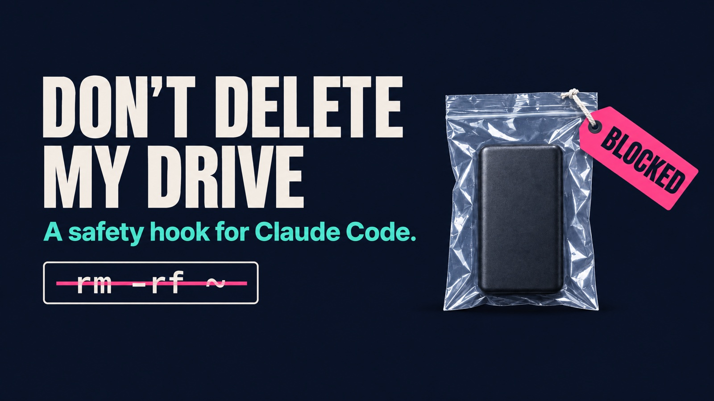

# dont-delete-my-drive



A safety hook for [Claude Code](https://claude.com/claude-code). It reads every shell command before it runs and refuses the ones that would wipe your disk, your home folder, your project, an external drive or your backups.

One command to install. Nothing to configure. macOS and Linux.

## Why

In October 2026 a developer posted that Claude Opus 5.5 had deleted his whole C: drive. He had been running Claude Code for hours with permission prompts off, a PowerShell command got mangled, and the drive was gone. His NAS backups gave him 98% of it back. Boris, who leads Claude Code at Anthropic, replied that auto mode "almost certainly would have caught this". ([Write-up](https://madrobot.blog/2026/10/07/claude-opus-5-5-deleted-c-drive-claude-code-auto-mode-boris-cherny/))

Auto mode is good and you should use it. It is a classifier, so every decision is a judgement call. This hook isn't. It parses the command, works out which paths would be deleted, and says no before anything runs. Keep both.

## Install

```bash
curl -fsSL https://raw.githubusercontent.com/GitDomHub/dont-delete-my-drive/main/install.sh | bash
```

Start a new Claude Code session afterwards so it loads the hook. That's it.

If you'd rather read before you run: clone the repo, open `install.sh` (it's short), then run `./install.sh`.

The installer copies one Python file to `~/.claude/hooks/`, backs up `~/.claude/settings.json`, and adds the hook plus a few permission rules to it. It touches nothing else. You need Python 3.6 or newer, which macOS and most Linux distributions already ship.

## What it does

Every command ends one of three ways. Blocked: Claude can't run it, and is told to stop and ask you to run it yourself if the step is really needed. Asks: you get Claude Code's normal permission prompt. Everything else runs exactly as before.

| Blocked | Asks you first | Runs as normal |
|---|---|---|
| `rm -rf` on `/`, `~`, `~/Documents`, `~/Desktop`, `~/Library`, `~/.ssh` and the other folders that hold your life | `rm -rf` on any other existing folder, unless it is a temp or build folder or every file in it is committed in git | `rm file.txt`, `rm -f *.bak`, `find . -name '*.tmp' -delete` |
| deleting the folder Claude is working in, or any folder above it | `rm -rf "$DIR/"` when the variable can't be resolved (an empty one turns it into `/`) | `rm -rf node_modules`, `dist`, `build`, `.next`, `target`, `.venv` |
| any external drive or mounted volume | a project's `.git` or `.claude` folder | `rm -rf /tmp/anything`, `rm -rf a-folder-that-does-not-exist` |
| `find ~ -delete`, `rsync --delete` onto those folders, `mv` of those folders | `xargs rm -rf` | `git push`, `git branch -d x && git push origin --delete x` |
| `sudo` and `doas` | `git reset --hard`, `git clean -f`, `git push --force`, `git branch -D`, `git checkout -- .`, `git stash drop` | `git clean -n`, `git restore --staged`, `git checkout -- one-file.md` |
| `diskutil erase*`, `dd` or `>` onto `/dev/disk*`, `mkfs`, `newfs`, `wipefs`, `fdisk`, `diskpart`, `Format-Volume` | `shutil.rmtree` or `fs.rmSync` in a script that also names your home folder or a drive, `DROP TABLE`, `wrangler ... delete`, `aws s3 rm`, `docker system prune` | `diskutil list`, `tmutil latestbackup` |
| deleting Time Machine snapshots, emptying the Trash | `shred`, `crontab -r`, `security delete-*` | `mv` and renames inside your projects, `trash old.md` |
| `gh repo delete` | editing this hook or `~/.claude/settings*.json` | `echo "rm -rf ~"`, `git commit -m "rm -rf / is scary"` |

It looks through `sudo`, `bash -c '...'`, `eval`, `ssh host '...'`, `osascript "do shell script"`, `$(...)` and backtick subshells, here-docs piped into a shell, `cd` before the delete, `~`, `$HOME`, and variables set earlier in the same command. `D=~/Documents && rm -rf $D` is blocked. `rm -rf "$UNSET/"` asks. Quoted strings, comments and plain here-docs are data, so the two examples in the last row run without a prompt.

Two things keep it quiet during normal work. A folder that does not exist is nothing to delete, so `rm -rf old-clone && git clone ...` runs when `old-clone` is already gone. A folder whose files are all committed in git can be restored, so deleting it runs too; one untracked or modified file in there and it asks.

When a command can't be parsed (unbalanced quotes, say) the hook falls back to pattern matching. When the hook itself crashes, or Python is missing, every shell command is blocked rather than waved through, and the error tells you why.

## What Claude sees

> dont-delete-my-drive blocked this command: rm -r on your home folder or a folder above it (/Users/you). This hook protects the disk, the home folder, the project and backups. Do not retry, rephrase, split it up, or script around it. If the step is really needed, stop and ask the user to run it themselves in a terminal.

The message is written for the model, so it knows the block is deliberate and what to do instead.

## The other two layers

The installer also adds to `settings.json`:

- `permissions.deny` rules for the literal worst cases (`rm -rf /`, `rm -rf ~`, `sudo *`, `mkfs*`, `gh repo delete*`). These hold even if the hook were ever disabled.
- `permissions.ask` rules so that any edit to `~/.claude/settings.json` or `~/.claude/hooks/` prompts you first. The hook can't be quietly switched off.
- `autoMode` rules that tell Claude Code's auto-mode classifier the same things in plain English, for what a shell parser can't see, like a Python script that calls `shutil.rmtree`.

## Config (optional)

Create `~/.claude/dont-delete-my-drive.json`:

```json
{
  "protected": ["~/Documents/MyVault", "/Volumes/Work/Clients"],
  "safe_to_delete_in": ["~/scratch"],
  "regenerable": [".gradle", "tmp"],
  "sudo": "ask"
}
```

`protected` lists folders Claude may never delete or move, nor any folder that contains them. Their top two levels of subfolders are blocked too (for a vault, that is the areas and the projects). Deeper inside, normal project rules apply, and moves and renames are fine anywhere. A single file in a top level asks instead of blocking.

`safe_to_delete_in` lists folders where recursive deletes run without a prompt, like `/tmp`. Your home folder and anything above it are ignored here on purpose.

`regenerable` adds folder names that may be deleted anywhere, in the spirit of `node_modules`.

`sudo` is `"deny"` (default) or `"ask"`. If you want Claude to run `sudo apt install` with a prompt, install with `./install.sh --sudo-ask`; it writes this key and leaves `sudo` out of the deny rules.

## Limits

- This is not a backup. It stops Claude. It doesn't stop a dying SSD, a stolen laptop, or you. The developer in the story got his data back because of a NAS, not a hook. Turn on Time Machine or whatever your platform calls it.
- Script files are opaque. `python3 cleanup.py` could do anything and the hook can't see inside the file. Inline scripts (`python3 -c "..."`, `node -e "..."`) are pattern-checked and ask. Auto mode covers the rest.
- Windows is pattern-matched, not parsed. `Remove-Item -Recurse` on a drive root or a user profile, `rd /s /q C:\`, `Format-Volume` and `diskpart` are blocked by regex; other recursive deletes ask. The path logic is written for `/` paths. Untested on a real Windows machine. WSL and Git Bash should behave like Linux. If you run Windows and want to help, open an issue.
- It only covers Claude Code's shell tools. Codex, Cursor and your own terminal have their own rules.
- It will be wrong sometimes. If something is blocked that shouldn't be, open an issue with the command. If something got through that shouldn't have, open one faster.

## Test it

```bash
python3 test_dont_delete_my_drive.py
```

215 cases: commands that must be blocked, commands that must ask, commands that must run without a prompt. Add yours.

The rules were tuned against a replay of 46 real Claude Code sessions, about 6,000 shell commands. Version 1.0 flagged 1.5% of them and roughly two thirds of those were unnecessary: renames, wildcard file deletes, merged-branch cleanup. Version 1.1 flags a third as many.

## Uninstall

```bash
./uninstall.sh
```

Backs up `settings.json`, removes the hook file, the hook entry and the rules the installer added, and leaves the rest of your settings alone.

## Provenance

Built at [Just Digital](https://justdigital.world) the morning after the thread, for a work vault that had no backup drive plugged in. MIT.
